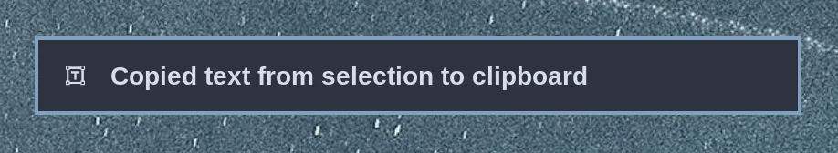

# Text Extraction & Dictation

### Text Extraction

Hit `Super + Ctrl + PrtScr` to select a region on the screen for text extraction. The tesseract open source OCR model will then quickly convert that selection into text and place it on the clipboard. Then you just hit `Super + V` to paste.

This is very helpful for grabbing addresses out of image footers or phone numbers embedded in website headlines.

 

### Dictation

On fresh installs, [Superwhisper](https://superwhisper.com/) is the default dictation backend, using cloud processing without offline model downloads. Choose Superwhisper or [Voxtype](https://voxtype.io/) through _Setup > Defaults > Dictation_ in the HeliOS menu. Selecting a backend installs it if needed and makes it the default for dictation. Voxtype loads a base English model that takes up 150MB; change the model with `voxtype setup model` and other settings through `~/.config/voxtype/config.toml`. Superwhisper opens its settings to choose cloud or local processing, and OPR keeps the application updated.

You dictate by holding down `Right Alt` or `F9`, or by toggling with `Super + Ctrl + X`, and the dictated text will appear in the focused input area. These shortcuts use the selected backend. Right Alt also starts dictation when used in a modifier chord; use Left Alt for those chords. On keyboard layouts where Right Alt is AltGr, use `F9` to keep AltGr available for typing.

The same shortcuts work with either backend. Select your backend through Setup > Defaults > Dictation. The backend installer configures it and saves the selection. Run `helios default dictation` to see which one is selected. The selection is saved in `~/.config/helios/defaults/dictation`. Fresh installs select Superwhisper automatically.

HeliOS loads the selected backend's desktop integration automatically. No Superwhisper configuration is needed in `~/.config/hypr/`.

Custom bindings and scripts can use `helios dictation start`, `helios dictation stop`, and `helios dictation toggle`. The selected backend handles the recording and transcription. Selecting Superwhisper disables its native hold shortcut and sets its native toggle to `Alt + Space`, keeping it separate from HeliOS's recording keys. Superwhisper requires at least one native recording shortcut, and its cancellation shortcut stays available.

Additional backends can integrate without changing HeliOS. Provide an executable named `helios-dictation-<backend>` on PATH that accepts `start`, `stop`, and `toggle` and returns promptly, with a nonzero status on failure. Its installer configures the provider and calls `helios-dictation-use <backend>` after successful setup. This stops the previous backend and saves the selection atomically; `stop` must succeed when the provider is idle or unavailable. Backend names use lowercase letters, digits, and hyphens. Provide `helios-install-dictation-<backend>` for setup; `helios default dictation <backend>` launches it. Add a Defaults menu entry through an HeliOS menu extension to call that selector. Optional desktop integration can live in `${XDG_CONFIG_HOME:-$HOME/.config}/<backend>/shortcuts.lua`.
